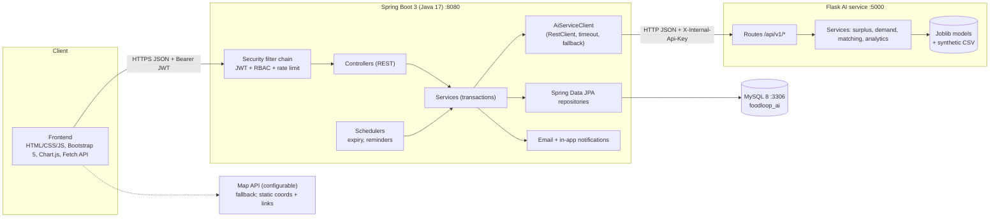
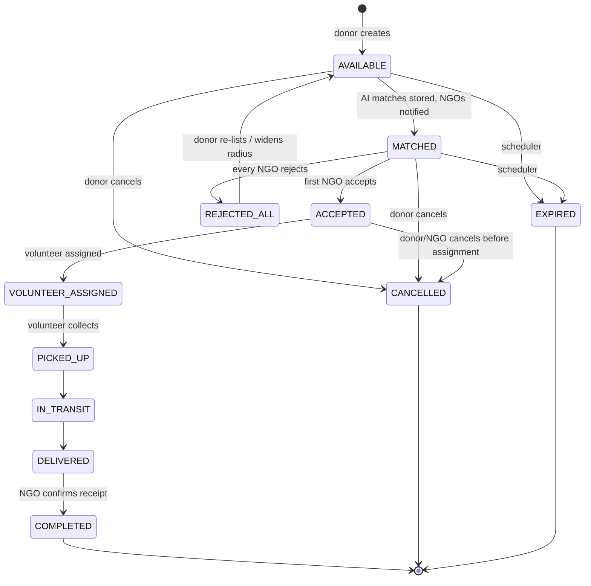

# FoodLoop AI – Requirement Analysis & System Architecture (FINAL v1.0)

## 1. Problem and goal
Large quantities of edible surplus food from restaurants, hotels, bakeries, supermarkets and events are thrown away while NGOs and food banks lack food. FoodLoop AI (1) predicts how much surplus a donor is likely to produce, (2) matches every donation to the most suitable NGOs with an explainable score, and (3) coordinates volunteer pickup and delivery, with full tracking and analytics.

## 2. Stakeholders / roles
| Role | Main goals |
|---|---|
| Admin | Verify donors & NGOs, monitor all donations, analytics, reports, complaints, audit logs |
| Donor | List surplus food, see AI surplus prediction, see matched NGOs, track donations |
| NGO | Post requirements, receive matches, accept/reject, schedule pickup, confirm receipt |
| Volunteer | See/accept pickup tasks, update pickup + delivery status, confirm delivery |

## 3. Functional requirements (FR)
| ID | Requirement | Module |
|---|---|---|
| FR-01 | Register (donor/NGO/volunteer), login, logout, forgot/reset password | Auth |
| FR-02 | New donor/NGO accounts stay PENDING until admin verifies | User mgmt |
| FR-03 | Role-based dashboards and navigation | Auth/UI |
| FR-04 | Donor creates/updates/cancels donation with images, expiry, safety declaration | Donation |
| FR-05 | Donation form shows AI-predicted surplus for donor/category/day | AI |
| FR-06 | On creation, system finds suitable NGOs and stores ranked matches with score breakdown | Matching |
| FR-07 | NGOs get in-app (and email) notification; first NGO to accept wins; others WITHDRAWN | Matching/Notify |
| FR-08 | NGO schedules pickup; system assigns/offers task to volunteers | Pickup |
| FR-09 | Volunteer accepts task, marks PICKED_UP, IN_TRANSIT, DELIVERED | Delivery |
| FR-10 | NGO confirms receipt (quantity received) -> donation COMPLETED | Delivery |
| FR-11 | Scheduler expires donations past expiry and sends expiry reminders | Expiry |
| FR-12 | NGO posts food requirements; AI demand prediction per category/area | AI |
| FR-13 | Search, sort, filter, paginate donations, users, logs | All |
| FR-14 | Ratings, feedback, complaints; admin responds | Feedback |
| FR-15 | Admin analytics + CSV/PDF reports | Analytics |
| FR-16 | Audit log for every sensitive action | Audit |
| FR-17 | Map display with fallback when no API key | Location |
| FR-18 | Waste pattern analytics (wasted categories, monthly trends) | AI |

## 4. Non-functional requirements (NFR)
Security (BCrypt, JWT, RBAC, validation, upload checks, CORS, rate limiting); Performance (paged APIs, indexed queries, AI call timeout 3 s with fallback); Reliability (system works if AI service is down – rule-based fallback, flagged in response); Usability (responsive, dark mode, accessible); Maintainability (layered architecture, tests); Portability (Windows 11 local + Docker Compose); Honesty (synthetic data and model metrics always labelled).

## 5. Architecture

**Key design decisions**
1. The Flask service is **stateless** and has **no DB access**. Java sends everything needed (candidate NGOs, aggregated stats) in the request. This keeps one source of truth (MySQL) and makes AI testable alone.
2. Java persists every AI call in `predictions` (with model name/version and `trained_on_synthetic` flag).
3. Only Java is exposed to the browser; Flask listens on localhost / Docker internal network and requires `X-Internal-Api-Key`.
4. Double-accept protection: `donations.version` (JPA `@Version`) + unique keys (`uq_dm`, `pickup_requests.donation_id`).
5. JWT: 15-min access token + `jti`; logout writes `jti` into `revoked_tokens`; filter rejects revoked tokens.
6. Images stored on disk under `uploads/` with random UUID names; only jpeg/png/webp, max 5 MB, content sniffed server-side.
7. Frontend is plain static files served by Nginx (Docker) or any static server in development.

## 6. Technology stack (fixed)
Frontend: HTML5, CSS3, JS, Bootstrap 5, Chart.js, Fetch API. Backend: Java 17, Spring Boot 3, Spring Security, Spring Data JPA/Hibernate, Maven, JWT (jjwt), springdoc-openapi. Database: MySQL 8. AI: Python, Flask, Pandas, NumPy, scikit-learn, Joblib. Tests: JUnit 5, Mockito, Spring Boot Test, pytest, Postman.

## 7. Donation status machine (single source of truth)

Rules: no skipping states; cancel only before PICKED_UP; each transition writes an `audit_logs` row and a notification. `deliveries.status` mirrors PICKED_UP/IN_TRANSIT/DELIVERED/RECEIPT_CONFIRMED and `pickup_requests.status` follows PENDING_ASSIGNMENT -> ASSIGNED -> VOLUNTEER_ACCEPTED -> PICKED_UP.
