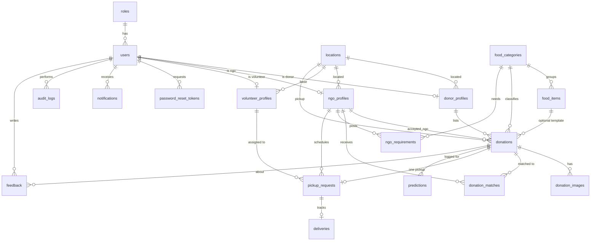

# Database Design (matches database/schema.sql – verified on MySQL 8.0.46)

20 tables + 2 views, 3NF. IDs are BIGINT; profiles share the PK of `users` (1:1).

## ER diagram


## Data dictionary (key columns)
| Table | Purpose | Important columns / rules |
|---|---|---|
| roles | 4 fixed roles | name UNIQUE |
| users | Login identity | email UNIQUE, password_hash (BCrypt), status PENDING/ACTIVE/SUSPENDED/REJECTED, phone CHECK |
| password_reset_tokens | Forgot password | SHA-256 token hash, expires_at, used |
| revoked_tokens | JWT logout | jti UNIQUE, expires_at (purged by scheduler) |
| locations | Address + lat/lng | CHECK ranges, index on (lat,lng) |
| donor_profiles | Donor details | donor_type, fssai_license_no, verification_status |
| ngo_profiles | NGO details | registration_number UNIQUE, daily_capacity_kg > 0, availability window |
| volunteer_profiles | Volunteer | vehicle_type, service_radius_km, availability_status |
| food_categories | 8 categories | safe_hours_after_prep guideline |
| food_items | Catalogue | kg_per_unit converts unit -> kg |
| donations | Core entity | quantity_kg, prepared_at < expires_at, safety_declared must be 1, status machine, `version` for optimistic lock |
| donation_images | Photos | UUID stored name, jpeg/png/webp, <= 5 MB |
| ngo_requirements | NGO needs | required_quantity_kg, needed_by, priority, status |
| donation_matches | AI ranking | match_score 0-100, distance_km, score_breakdown JSON, UNIQUE(donation, ngo) |
| pickup_requests | Pickup | donation_id UNIQUE, volunteer nullable until assigned |
| deliveries | Tracking | status, timestamps, quantity_received_kg, last lat/lng |
| notifications | In-app + email state | is_read, email_status |
| predictions | AI audit trail | input/output JSON, model_name, model_version, trained_on_synthetic |
| feedback | Ratings & complaints | rating 1-5, UNIQUE(donation, from_user, kind) |
| audit_logs | Security trail | old/new JSON, ip |
| v_admin_summary | Admin KPI cards | |
| v_monthly_category_stats | Monthly/category trends, wasted vs redistributed kg | |

## Integrity features proven by running the scripts
- Inserting a donation with `safety_declared = 0` is rejected (`chk_don_safety`).
- Inserting a second match for the same donation+NGO is rejected (`uq_dm`).
- Sample data: every accepted donation's pickup NGO equals `accepted_ngo_id` (0 mismatches); every match score equals the sum of its breakdown (0 mismatches).

## Backup and restore (Windows 11, Command Prompt)
```
:: backup
"C:\Program Files\MySQL\MySQL Server 8.0\bin\mysqldump" -u root -p --routines foodloop_ai > database\backup\foodloop_backup.sql
:: restore
"C:\Program Files\MySQL\MySQL Server 8.0\bin\mysql" -u root -p -e "CREATE DATABASE IF NOT EXISTS foodloop_ai"
"C:\Program Files\MySQL\MySQL Server 8.0\bin\mysql" -u root -p foodloop_ai < database\backup\foodloop_backup.sql
```
Load fresh dev database: `mysql -u root -p < database\schema.sql` then `mysql -u root -p < database\sample_data.sql`.

## Demo accounts (all password `Password@123`, fictional)
admin@foodloop.test | annapoorna@foodloop.test (donor) | hopemeals@foodloop.test (NGO) | vol.karthik@foodloop.test (volunteer) | seva@foodloop.test (pending NGO for verification demo). Change/remove before any real deployment.
