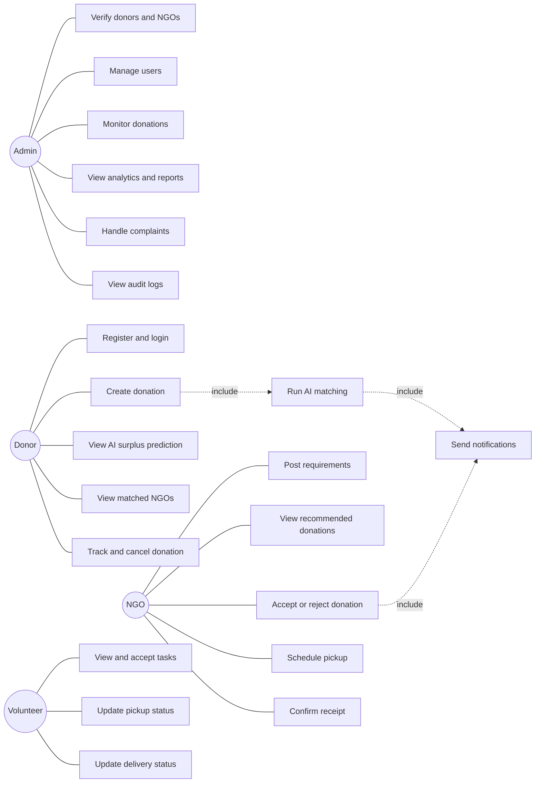
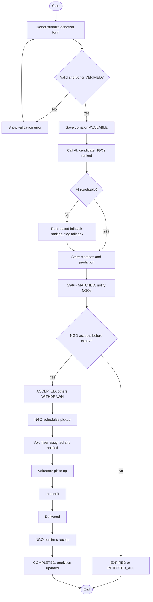
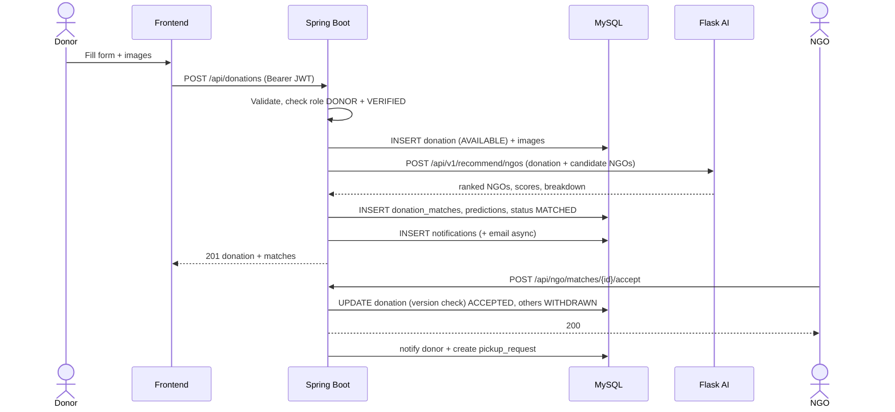
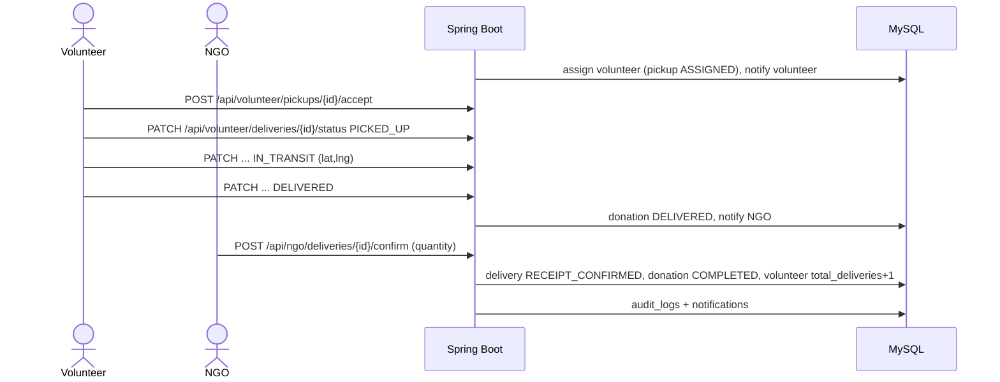
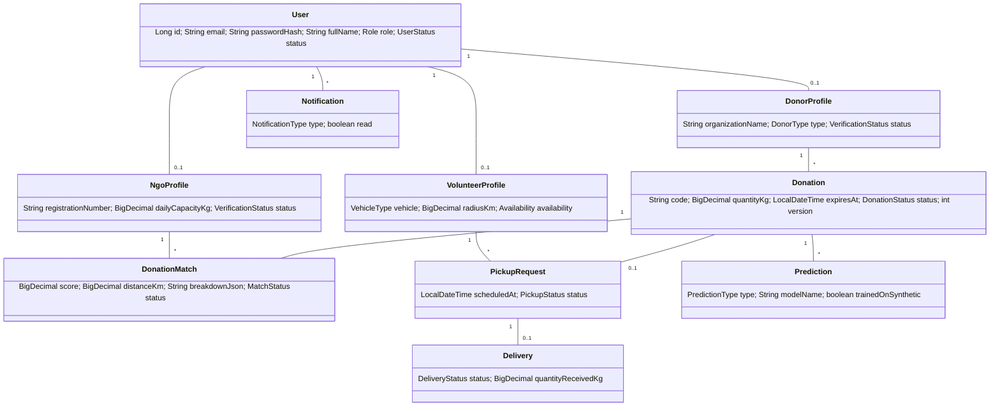
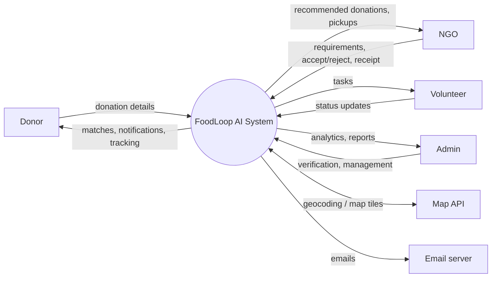
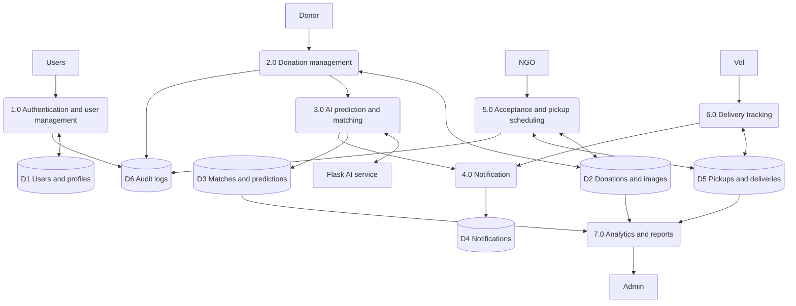
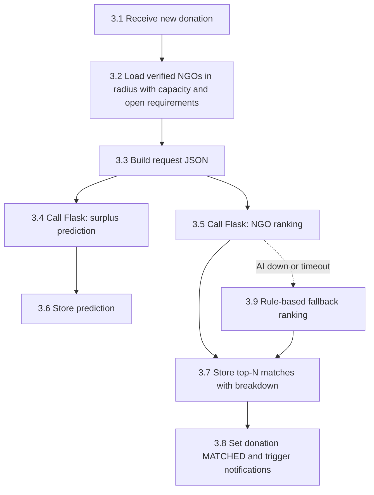

# UML and DFD Diagrams (Mermaid – renders on GitHub, VS Code Markdown Preview, mermaid.live)

## 1. Use-case diagram

## 2. Activity diagram – donation lifecycle

## 3. Sequence diagram – create donation and match

## 4. Sequence diagram – delivery

## 5. Class diagram (core domain)

## 6. DFD Level 0 (context)

## 7. DFD Level 1

## 8. DFD Level 2 – process 3.0 AI prediction and matching

